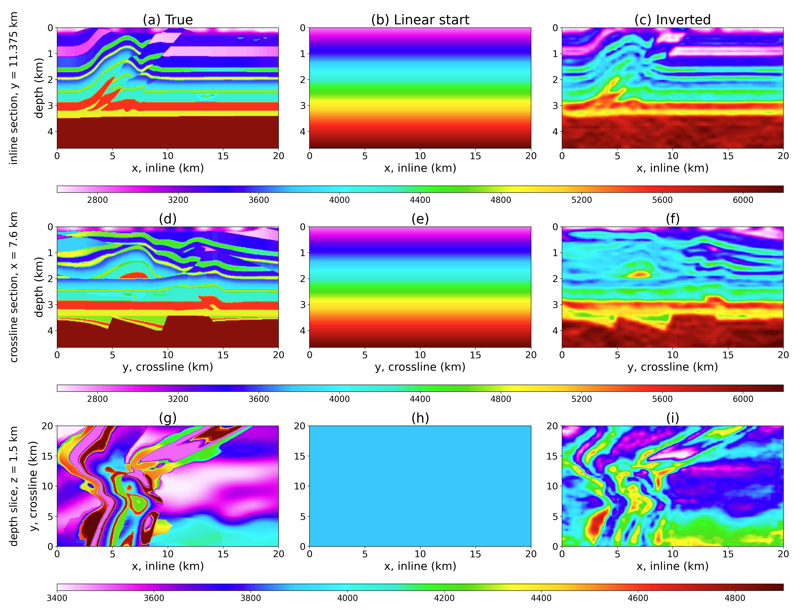

# 3DIFWI-PUB: 3-D implicit FWI with frequency-selection encoding

These scripts reproduce the 3-D SEG/EAGE Overthrust example of

> Shaowen Wang and Tariq Alkhalifah. Three Ways to Afford 3D Implicit FWI: Source–Receiver
> Reciprocity, Frequency-Selection Encoding, and Domain Decomposition on a Field Ocean-Bottom-Node
> Dataset. Submitted to *Computers & Geosciences*.

The field example of the paper uses proprietary data and is not included. The options, inputs
and outputs of each script are described in [USER_GUIDE.md](USER_GUIDE.md).

## Install

Linux, an NVIDIA GPU and Python 3.9 or newer:

```bash
pip install torch --index-url https://download.pytorch.org/whl/cu128   # cu126 on V100
pip install "sweep-solver==0.3.6" scipy matplotlib h5py
```

## Run

```bash
python overthrust_forward.py --workdir overthrust    # observed data, once
python overthrust_invert.py  --workdir overthrust    # inversion, one GPU
python overthrust_figures.py --workdir overthrust    # error against the true model, figures
```

The first step downloads the Overthrust model from Zenodo
([doi:10.5281/zenodo.4252588](https://doi.org/10.5281/zenodo.4252588), 531 MB). To split the model
across four GPUs, as in the paper:

```bash
torchrun --standalone --nproc-per-node 4 overthrust_invert.py --workdir overthrust --dd 2x2
```

## Expected results

The inversion runs five frequency bands from 2–4 Hz to 2–16 Hz, 200 iterations in total. On one
H100 it takes 1.2 hours with at most 47 GB of GPU memory; on four A100 GPUs with `--dd 2x2` it
takes 47 minutes. The r.m.s. error against the true model drops from 454 m/s to about 215 m/s.


